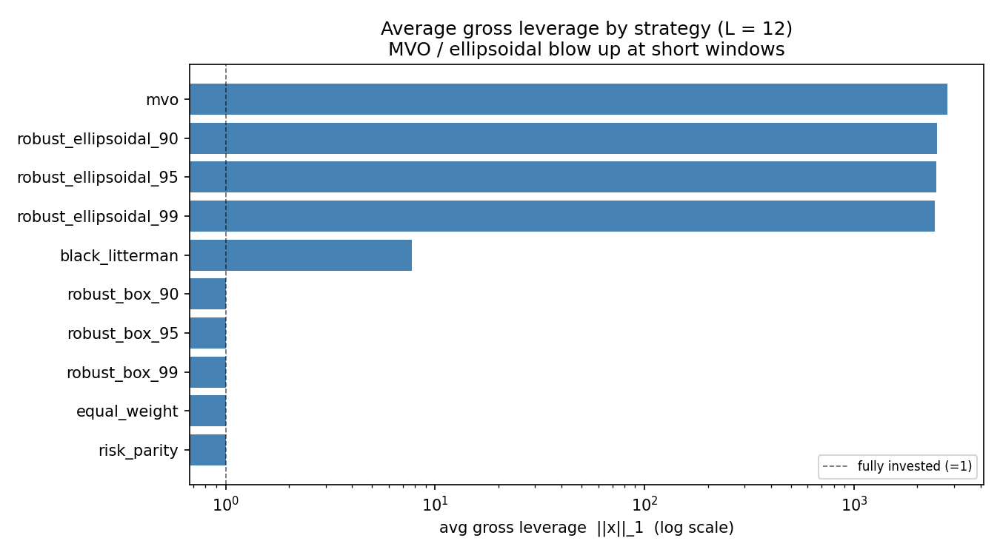
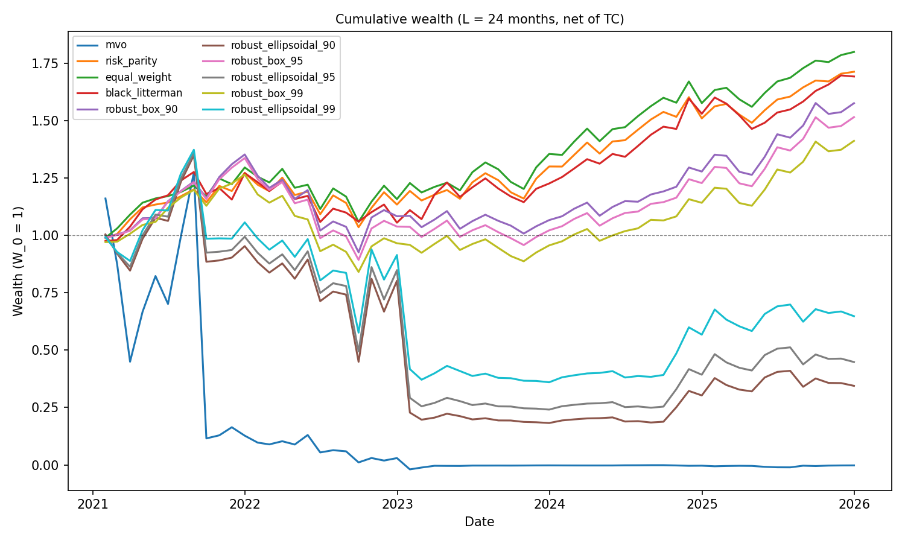

# When Mean-Variance Optimization Meets Real Data

What happens to the textbook portfolio model when its inputs have to be estimated, and which
of the standard remedies deal with the cause rather than the symptom? A rolling
out-of-sample study on the eleven SPDR S&P 500 sector ETFs, 2019–2025.

## Why this study

Mean-variance optimization (MVO) is the first model anyone learns for building a portfolio,
and on paper it is hard to argue with: give it the expected returns `μ` and the covariance
matrix `Q`, and it returns the best possible trade-off between return and risk.

The catch is in "give it". Nobody knows `μ` and `Q`. They are estimated from a limited
history, and MVO treats those estimates as if they were the truth. Practitioners have known
for decades that this goes badly, and almost none of them run MVO unmodified. The usual
explanation is two words long, "estimation error", which is correct and explains very little.
It suggests a portfolio that is somewhat worse than optimal. What actually happens is
different in kind.

Here is the mechanism in its simplest form. Take 11 assets and six months of returns. With
so few observations you can always build long-short combinations of the 11 assets whose
return did not vary at all during those six months. The sample covariance `Q̂` therefore
rates these combinations as riskless. If the estimated mean `μ̂` says that any one of them
earned a positive return, the optimizer sees a riskless profit and wants an unlimited
amount of it.

At that point the problem is no longer "slightly wrong inputs". The optimization has no
finite solution, and the weights a solver prints are decided by its numerical tolerance, not
by anything in the market. The failure is numerical before it is financial.

That is what makes this worth studying carefully:

- **It is the gap between the model as taught and the model as used.** Understanding exactly
  where MVO breaks is what makes sense of everything practitioners do instead.
- **It is not specific to this dataset.** Any pipeline that feeds estimated moments into an
  optimizer has the same structure: factor portfolios, risk budgeting, hedging. Most of
  them have far more assets per observation than the 11-asset case here, so the problem is
  worse, not better.
- **The remedies are not interchangeable.** Robust optimization, Bayesian shrinkage,
  dropping the return forecast, and dropping estimation altogether are all presented as
  answers to estimation error. They act on different parts of the problem, and there is no
  reason to assume they all work.

## What this study asks

The goal is not to find the strategy with the highest Sharpe ratio. It is to make the effect
of estimation error visible and to understand what it takes to contain it.

1. **How severe is the failure at realistic sample sizes?** Does it disappear once there is
   enough data for `Q̂` to be invertible?
2. **Which remedies address the mechanism?** Among the standard responses to estimation
   error, which ones stop the optimizer from exploiting trades that only look riskless, and
   why?
3. **What does stability cost?** Once a portfolio is well-behaved, how much does it give up
   in turnover and transaction costs?

## How the study is set up

**The experiment.** Each month, estimate `μ̂` and `Q̂` from the previous `L` months only,
build every portfolio, hold it for one month, record the realized return net of transaction
costs, and roll forward. Month `t` is never used to choose the portfolio that is evaluated
on month `t`.

**The dial.** The estimation window `L` is the control variable. Three values move the
amount of data per asset across the range that matters:

| Window | Observations vs. 11 assets | State of `Q̂` |
|---|---|---|
| `L = 6` | fewer observations than assets | singular |
| `L = 12` | just enough | invertible, barely |
| `L = 24` | about twice as many | well-posed, still noisy |

**The strategies.** Plain MVO is the subject. The other five are the standard routes for
dealing with estimation error, and each one intervenes at a different point:

| Strategy | Where it intervenes | Code |
|---|---|---|
| Mean-variance (MVO) | Nowhere. Short selling allowed, no regularization | `mean_variance` |
| Robust MVO, ellipsoidal set | Penalizes uncertainty in the mean: `ρ·√(xᵀSx)`, `S = Q̂/L` | `robust_ellipsoidal` |
| Robust MVO, box set | Penalizes uncertainty in the mean: `δᵀ\|x\|`, `δᵢ = z·√(Q̂ᵢᵢ/L)` | `robust_box` |
| Black–Litterman → MVO | Replaces `μ̂` with a posterior shrunk toward equilibrium | `black_litterman` |
| Risk parity | Does not use `μ`; long-only, equal risk contributions | `risk_parity` |
| Equal weight (1/N) | Does not estimate anything | `equal_weight` |

MVO is deliberately left unregularized. Shrinking `Q̂` or capping leverage would give usable
numbers and remove the thing being studied.

**Details.**

| | |
|---|---|
| Universe | XLK, XLF, XLE, XLY, XLP, XLV, XLI, XLB, XLU, XLRE, XLC |
| Data | Monthly returns from end-of-month adjusted prices, 2019-01 to 2025-12 (84 months) |
| Transaction costs | 10 bps on turnover `‖x_t − x_{t−1}‖₁`; the first month pays the full cost of building the position |
| Risk aversion | `λ = 2.5` for every optimizer, so differences come from the model and not the tuning |
| Robust confidence levels | 90%, 95%, 99% for both uncertainty sets |
| Black–Litterman view | XLK outperforms XLU by 0.25% per month, `τ = 0.05`, equal-weight market proxy |

The models are pure functions `(μ̂, Q̂) → weights` in [src/models.py](src/models.py); the
rolling driver is [src/backtest.py](src/backtest.py).

## What the data show

### MVO under three amounts of data

| Window | rank of `Q̂` (of 11) | median cond(`Q̂`) | MVO average gross leverage `‖x‖₁` | MVO out of sample |
|---|---|---|---|---|
| `L = 6` | 5 | singular | 1.3 × 10¹⁰ | wealth passes through zero |
| `L = 12` | 11 | 2.7 × 10⁴ | 2,779 | wealth passes through zero |
| `L = 24` | 11 | 376 | 39.5 | loses all capital; net Sharpe −0.08 (annualized) |

Gross leverage of 1.0 means fully invested with no short positions. At `L = 6` the
"riskless" trades described above form a five-dimensional space, and in the median window
32% of the norm of `μ̂` points into it.

### Position sizes under each remedy

Average gross leverage `‖x‖₁`:

| Strategy | `L = 6` | `L = 12` | `L = 24` |
|---|---|---|---|
| MVO | 1.3 × 10¹⁰ | 2,779 | 39.5 |
| Robust, ellipsoidal (95%) | 1.3 × 10¹⁰ | 2,468 | 11.0 |
| Robust, box (95%) | 1.10 | 1.00 | 1.00 |
| Black–Litterman | 2.13 | 7.75 | 2.38 |
| Risk parity | 1.00 | 1.00 | 1.00 |
| Equal weight | 1.00 | 1.00 | 1.00 |



### Out-of-sample performance

Net-of-cost annualized Sharpe ratio, and average monthly turnover at `L = 24`:

| Strategy | `L = 6` | `L = 12` | `L = 24` | Turnover (`L = 24`) |
|---|---|---|---|---|
| Equal weight | 0.82 | 0.77 | **0.89** | 0.02 |
| Risk parity | **0.83** | 0.78 | 0.83 | 0.05 |
| Black–Litterman | 0.67 | **0.79** | 0.79 | 0.75 |
| Robust, box (95%) | 0.29 | 0.58 | 0.58 | 0.39 |
| Robust, ellipsoidal (95%) | n/a | n/a | 0.07 | 5.38 |
| MVO | n/a | n/a | −0.08 | 16.5 |

"n/a" marks runs where wealth crosses zero, so return statistics have no economic meaning.



## Answers to the three questions

### 1. The failure is severe, and more data shrinks it without removing it

At `L = 6` the problem is unbounded in exact arithmetic. The 10¹⁰ leverage figure comes from
the 10⁻¹² eigenvalue floor that makes the problem solvable at all; it describes the solver
setup, not the market.

`L = 12` is the more instructive case. `Q̂` is invertible, the problem is well-defined, and
leverage is still in the thousands. At `L = 24` the condition number is comfortable and the
portfolio is levered 40×, loses 80% of its capital within nine months and all of it by
month 25. A singular covariance matrix is the extreme end of a continuous problem, not a
separate one.

### 2. A remedy works when it acts where the risk model is blind

The five alternatives split cleanly, and one question explains the split: does the method
still restrain a trade that `Q̂` rates as riskless?

**Ellipsoidal robustness does not.** Its penalty measures estimation risk as `√(xᵀSx)` with
`S = Q̂/L`, which is the same matrix rescaled. Wherever `Q̂` sees no risk, `S` sees no
estimation error. The correction is computed with the instrument that is broken, so it
vanishes in exactly the directions where it is needed. Leverage reaches the same 10¹⁰ at
`L = 6`, and the model helps only modestly once `Q̂` is already well-conditioned.

**Box robustness does.** `δᵀ|x|` is a weighted ℓ₁ norm and is strictly positive in every
direction (the smallest `δᵢ` across all `L = 6` windows is 0.0086). Every long-short trade
pays on both legs regardless of what `Q̂` says about it. What is motivated as a robustness
adjustment to the mean acts, in effect, as a leverage constraint. This is the mechanism
behind the norm-constrained portfolios of DeMiguel, Garlappi, Nogales and Uppal (2009) and
the "wrong constraints help" result of Jagannathan and Ma (2003).

**Black–Litterman removes the incentive instead of adding a penalty.** Its posterior mean is
built from `Q̂` itself (`Π = δ·Q̂·w` plus a `Q̂`-weighted view correction), so it has no
component in the riskless space: of order 10⁻¹¹ at `L = 6`, against 32% for `μ̂`. The
optimizer is never told that a riskless trade is profitable.

**Risk parity and equal weight step outside the problem.** One discards `μ` and imposes
`x > 0`; the other estimates nothing.

### 3. Stability has a price, and simplicity is cheapest

Among the strategies that stay bounded, performance runs in reverse order of
sophistication: the fewer quantities a strategy estimates, the better it does net of costs.
This reproduces the 1/N result of DeMiguel, Garlappi and Uppal (2009) on a different
universe and period.

Black–Litterman shows the cost most clearly. At `L = 12` it has the highest terminal wealth
of any strategy (3.20) and turns its portfolio over 7.4× per month, giving up 0.74% of
return per month to a 10 bps cost. Bounded is not the same as cheap to run.

## Conclusion

Estimation error is not a small perturbation of the textbook problem. At realistic sample
sizes it changes which problem is being solved: the optimizer is handed a risk model with
blind spots and a return forecast that points into them. Whatever is added to contain that,
whether a penalty, a prior or a constraint, ends up determining the portfolio more than the
mean-variance objective does. The choice of regularizer is the model.

Three things follow from that.

- **"Robust" describes an uncertainty set, not a portfolio.** Two models with the same
  motivation and the same confidence level behave in opposite ways, because one penalty is
  degenerate where the other is not. The shape of the set matters more than its size: no
  confidence level rescues the ellipsoidal model at short windows, and the box model stays
  bounded at all three.
- **Check conditioning before reading performance.** Gross leverage and the condition number
  of `Q̂` flagged the failure before a single return was realized. A backtest that reports
  only Sharpe ratios would show the blown-up runs as noisy rather than as ill-posed.
- **A simple portfolio is a benchmark to beat, not a fallback.** If a method cannot
  outperform 1/N after costs, its extra machinery is spending estimation risk without
  earning anything for it.

## Limitations

- **One sample, short tracks.** 60 to 78 out-of-sample months. The standard error of an
  annualized Sharpe ratio over 60 months is roughly 0.45 (i.i.d. approximation of Lo, 2002),
  so the ranking among equal weight, risk parity and Black–Litterman is not statistically
  distinguishable. The stability results differ by orders of magnitude and do not depend on
  that ranking.
- **`λ` is fixed at 2.5.** A larger `λ` scales down the speculative part of the MVO
  position at `L = 12` and `L = 24`; it does not make the `L = 6` problem bounded. A
  sensitivity sweep is not yet done.
- **Black–Litterman uses an equal-weight market proxy** and a single illustrative view, not
  capitalization weights.
- **Blown-up magnitudes are solver-dependent.** The direction of the result is not; the
  exact exponent is.
- **Sample period** includes the 2020 crash and the 2022 rate cycle; no sub-period analysis.

## Next steps

1. Add Ledoit–Wolf shrinkage and an explicit leverage cap to MVO, to test the conclusion
   directly: if it is right, repairing `Q̂` should also repair the ellipsoidal model.
2. Sweep `λ ∈ {1, 2.5, 5, 10, 25}` and report leverage, Sharpe and turnover against it.
3. Rebuild the Black–Litterman prior from sector market-cap weights.
4. Sub-period robustness (excluding 2020; splitting at 2022).

## Reproduce

```bash
python -m venv .venv && source .venv/bin/activate
pip install -r requirements.txt
python run.py
```

`python run.py` rebuilds every table in `results/` and every figure in `figures/` from the
cached backtests, so it reproduces the numbers above exactly. `python run.py --force`
re-solves every model from scratch; the stable strategies reproduce, while the blown-up
MVO and ellipsoidal magnitudes may shift with the solver path. `python run.py --download`
refreshes prices first.

Tested on Python 3.9 with the pinned versions in [requirements.txt](requirements.txt).

### Tests

```bash
pytest
```

The suite checks the claims the results rest on: no look-ahead (perturbing a future month
leaves all earlier weights unchanged), the budget constraint `eᵀx = 1`, equalized risk
contributions in risk parity, the Black–Litterman posterior moving toward the view, the
identity `net = gross − c·turnover`, and each performance-metric formula.

### Layout

```
src/
  data.py        download adjusted prices -> data/monthly_returns.csv
  models.py      the six models as pure (mu, Q) -> weights functions
  backtest.py    rolling out-of-sample driver, turnover and transaction costs
  metrics.py     Sharpe, Sortino, max drawdown, turnover, cost-impact tables
  figures.py     cumulative wealth, rolling Sharpe, weight heatmaps, frontier, leverage
run.py           one command: backtest -> results/ -> figures/
tests/           pytest suite
data/            monthly_returns.csv
results/         cached backtests and performance / turnover / tc_impact tables
figures/         all figures
```

On macOS with numpy 2.0 and the Accelerate BLAS backend, `matmul` can emit spurious
`RuntimeWarning`s on finite results. They are harmless and filtered in `pytest.ini`.

## References

- Markowitz, H. (1952). Portfolio selection. *Journal of Finance*, 7(1).
- Michaud, R. (1989). The Markowitz optimization enigma: Is "optimized" optimal? *Financial Analysts Journal*, 45(1).
- Best, M., & Grauer, R. (1991). On the sensitivity of mean-variance-efficient portfolios to changes in asset means. *Review of Financial Studies*, 4(2).
- Chopra, V., & Ziemba, W. (1993). The effect of errors in means, variances, and covariances on optimal portfolio choice. *Journal of Portfolio Management*, 19(2).
- Black, F., & Litterman, R. (1992). Global portfolio optimization. *Financial Analysts Journal*, 48(5).
- Lo, A. (2002). The statistics of Sharpe ratios. *Financial Analysts Journal*, 58(4).
- Jagannathan, R., & Ma, T. (2003). Risk reduction in large portfolios: Why imposing the wrong constraints helps. *Journal of Finance*, 58(4).
- Goldfarb, D., & Iyengar, G. (2003). Robust portfolio selection problems. *Mathematics of Operations Research*, 28(1).
- Tütüncü, R., & Koenig, M. (2004). Robust asset allocation. *Annals of Operations Research*, 132.
- Ledoit, O., & Wolf, M. (2004). Honey, I shrunk the sample covariance matrix. *Journal of Portfolio Management*, 30(4).
- DeMiguel, V., Garlappi, L., & Uppal, R. (2009). Optimal versus naive diversification: How inefficient is the 1/N portfolio strategy? *Review of Financial Studies*, 22(5).
- DeMiguel, V., Garlappi, L., Nogales, F., & Uppal, R. (2009). A generalized approach to portfolio optimization: Improving performance by constraining portfolio norms. *Management Science*, 55(5).
- Maillard, S., Roncalli, T., & Teïletche, J. (2010). The properties of equally weighted risk contribution portfolios. *Journal of Portfolio Management*, 36(4).
- Cornuéjols, G., Peña, J., & Tütüncü, R. (2018). *Optimization Methods in Finance* (2nd ed.). Cambridge University Press.

*This is a research exercise on historical data, not investment advice.*
