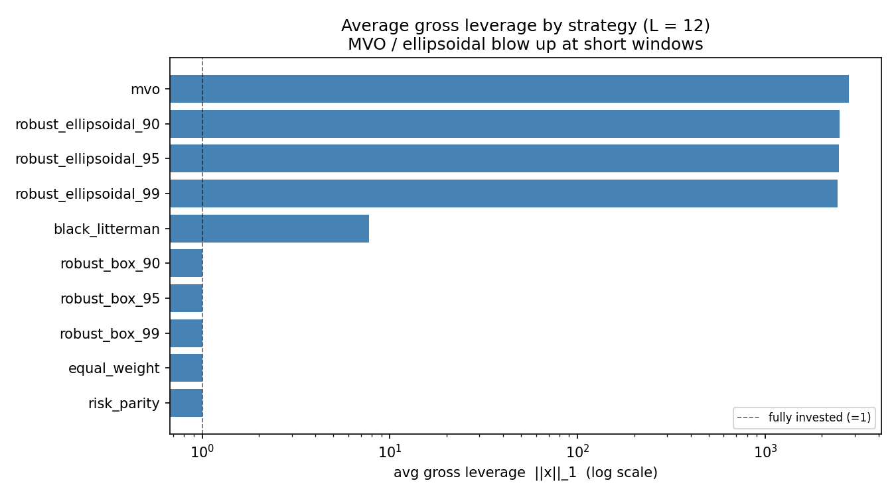
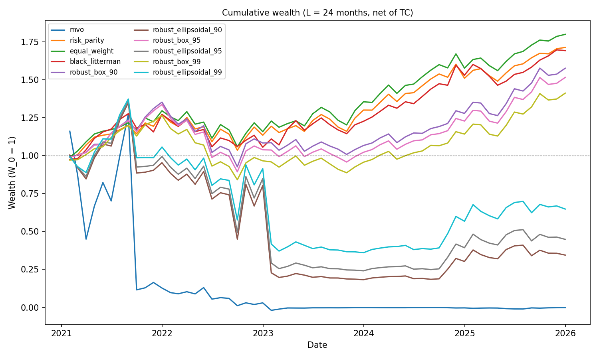

[English](README.md) | 简体中文

# 当均值-方差优化遇上真实数据


教科书里的组合模型，在输入只能靠估计时会发生什么？常见的几种补救方法里，哪些治的是病根，哪些只是压住了症状？本研究用 11 只 SPDR 标普 500 行业 ETF，在 2019–2025 年的数据上做滚动样本外检验。

## 模型：均值-方差优化

均值-方差优化（MVO）要确定组合权重 `x`（每个资产一个数），它需要两个输入：

- `μ`：每个资产的期望收益
- `Q`：收益的协方差矩阵

它求解的问题是

```math
\max_{x} \;\; \mu^\top x \;-\; \lambda\, x^\top Q\, x \qquad \text{s.t.} \qquad e^\top x = 1
```

| 项 | 含义 |
|---|---|
| `μᵀx` | 组合的期望收益 |
| `xᵀQx` | 组合的方差 |
| `λ` | 风险厌恶系数：一单位方差要用多少收益来补偿 |
| `eᵀx = 1` | 预算约束：权重之和为 1（`e` 是全 1 向量）；允许卖空 |

这个问题有闭式解：

```math
x^\star = \frac{1}{2\lambda}\, Q^{-1}\left(\mu - \gamma e\right),
\qquad
\gamma = \frac{e^\top Q^{-1}\mu - 2\lambda}{e^\top Q^{-1} e}
```

要注意的是其中的 `Q⁻¹`。**只有 `Q` 可逆，这个解才存在。**

## Challenge 1：没有人知道真实的 `μ` 和 `Q`

模型把 `μ` 和 `Q` 当作已知。现实中两者都观测不到，只能用过去 `L` 个月的收益 `r₁, …, r_L` 来估计：

```math
\hat{\mu} = \frac{1}{L}\sum_{t=1}^{L} r_t,
\qquad
\hat{Q} = \frac{1}{L-1}\sum_{t=1}^{L} \left(r_t - \hat{\mu}\right)\left(r_t - \hat{\mu}\right)^\top
```

然后 MVO 把 `μ̂` 和 `Q̂` 当作真值来用。

- 如果历史数据非常长，估计值会接近真值，这样做没有问题。
- 实际能用的历史很短，因为市场在变，太久以前的数据已经不再适用。
- 所以优化器拿到的是带噪声的输入，而它自己并不知道这一点。

## Challenge 2：数据太少时，问题根本解不出来

以本研究的设定为例：`n = 11` 个资产，假设只有 `L = 6` 个月的收益数据。

1. **`Q̂` 不满秩。**
   `Q̂` 是一个 11 × 11 的矩阵，却只由 6 个观测构造出来。减去均值之后，其中只有 5 个是独立的，所以

   ```math
   \text{rank}(\hat{Q}) \;\le\; L - 1 \;=\; 5 \;<\; 11
   ```

2. **所以 `Q̂` 是奇异矩阵，不可逆。**
   求解公式需要 `Q̂⁻¹`，而它算不出来。

3. **从组合的角度看，有些交易看起来没有风险。**
   `Q̂` 奇异意味着存在多空组合 `d` 使得 `Q̂d = 0`。这些组合在这 6 个月里的收益完全没有波动，所以估计出的方差恰好是零。

4. **优化器会想要无限多的这种交易。**
   如果 `μ̂` 显示这样一笔交易是赚钱的，那么加入 `t` 份它，期望收益上升，估计的风险却不增加：

   ```math
   \hat{Q}d = 0,\;\; e^\top d = 0,\;\; \hat{\mu}^\top d > 0
   \quad\Longrightarrow\quad
   f(x + t\,d) \;=\; f(x) + t\,\hat{\mu}^\top d \;\longrightarrow\; \infty
   ```

   其中 `f` 是 MVO 的目标函数。最优组合不存在。

5. **求解器仍然会输出一组数字。**
   这些数字由它的数值容差决定，与市场无关。

## Challenge 3：即使解得出来，答案也很脆弱

现在假设数据多到 `Q̂` 可逆。Challenge 2 的问题并没有消失，只是换了一种温和些的形式：解是存在的，但输入稍微变一点，解就会变很多。

**一个两资产的例子。** 取两个波动率同为 `σ`、相关系数为 `ρ` 的资产。手算 MVO 可以得到两者权重之差：

```math
x_1 - x_2 \;=\; \frac{\mu_1 - \mu_2}{2\lambda\,\sigma^2\,(1 - \rho)}
```

可以这样读：期望收益的差，除以这两个资产有多不一样。

- 如果两个资产毫不相关（`ρ = 0`），分母大，头寸小。
- 如果两个资产几乎同涨同跌（`ρ → 1`），分母趋于零。这两个资产近似于可以互相替代，“买一个、卖空另一个”看起来几乎没有风险，于是只要它们的期望收益有一点差别，优化器就会建立巨大的头寸。

取 `λ = 2.5`，`σ = 5%`（月度），期望收益之差只有每月 0.1%：

| 相关系数 `ρ` | 权重之差 `x₁ − x₂` |
|---|---|
| 0 | 0.08 |
| 0.9 | 0.8 |
| 0.99 | 8 |
| 0.999 | 80 |

每一行的收益预测都一样，变的只有相关系数，头寸却放大了一千倍。

**为什么实际中会出问题。** 两件事同时发生。

1. **资产之间相关，所以 `Q̂` 接近奇异。**
   行业 ETF 都跟着大盘走。有 11 个资产时，问题不只出在两两之间：只要某几个资产的组合能近似复制另一个资产，效果就是一样的；而在短样本里，这样的组合还会因为巧合而出现。

2. **收益预测的噪声很大。**
   估计均值的标准误是

   ```math
   \text{SE}(\hat{\mu}_i) = \frac{\sigma_i}{\sqrt{L}}
   ```

   它只随数据量的平方根下降。

合在一起：优化器在一些期望收益的差异上建立了很大的头寸（第 1 点），而这些差异大部分只是估计噪声（第 2 点）。噪声每个月都不一样，所以头寸会不停地翻转。

在本研究的数据里：

- 11 只 ETF 两两之间的平均相关系数是 0.63。
- ETF 的月度平均收益平均为 1.2%，月度波动率平均为 5.8%。`L = 24` 时，这个均值的标准误是 5.8% / √24 ≈ 1.2%，和均值本身一样大。
- 把某一只 ETF 的估计均值上调每月 0.1%（只有上述标准误的十二分之一），`L = 24` 时 MVO 的权重合计变动 2.0，相当于交易了组合价值的 200%。`L = 12` 时这个数字约为 21。（均为所有窗口和资产上的中位数。）

**一般情形下的度量：条件数。** 资产多于两个时，`1 − ρ` 的角色由 `Q̂` 的特征值来扮演：

```math
\kappa(\hat{Q}) = \frac{\lambda_{\max}(\hat{Q})}{\lambda_{\min}(\hat{Q})}
```

- `λ_min` 很小，意味着存在某个组合，它的估计方差几乎为零。这就是上面例子里“几乎没有风险”的那笔交易。
- `κ` 越大，`Q̂⁻¹` 对误差的放大越厉害。对于解的核心步骤 `Q̂⁻¹μ̂` 来说，输入中 1% 的误差最多可以变成结果中 `κ`% 的误差。
- `κ = ∞` 就是 `Q̂` 奇异，也就是 Challenge 2。

所以 Challenge 2 是 Challenge 3 的极端情形，而不是另一个问题。本研究使用的三个估计窗口覆盖了这两种情况：

| 窗口 | `Q̂` 的状态 | 对应哪个 Challenge |
|---|---|---|
| `L = 6` | 奇异，`κ = ∞` | Challenge 2：无解 |
| `L = 12` | 可逆，接近奇异 | Challenge 3，严重 |
| `L = 24` | 可逆，条件较好 | Challenge 3，较轻 |

## 应对三个 Challenge 的五种方法

本研究中的其他模型，都是应对这些问题的标准做法。它们介入的位置不同：

- 两种改的是**目标函数**（鲁棒 MVO，对应两种形状的不确定集）；
- 一种改的是**收益预测**（Black–Litterman）；
- 两种干脆**不再使用这些输入**（风险平价、等权）。

需要记住一点：**这五种方法都没有修复 `Q̂` 本身。** 它们各自用不同的办法绕开那个脆弱的逆矩阵。这样够不够，正是本研究要检验的。

### 鲁棒 MVO：为最坏情况做打算

**思路。** 承认 `μ̂` 不确定。假设真实的 `μ` 落在 `μ̂` 周围的某个集合 `U` 里，然后选一个“即使出现集合里最坏的 `μ`，表现也最好”的组合：

```math
\max_{x}\; \min_{\mu \in U}\; \mu^\top x \;-\; \lambda\, x^\top \hat{Q}\, x \qquad \text{s.t.} \qquad e^\top x = 1
```

里面那个最小化可以手算出来，结果是从 MVO 目标函数里减去一个惩罚项。`U` 的形状决定了惩罚项长什么样。

**版本 A：椭球不确定集**（`robust_ellipsoidal`）

```math
\max_{x}\; \hat{\mu}^\top x \;-\; \rho\sqrt{x^\top S\, x} \;-\; \lambda\, x^\top \hat{Q}\, x,
\qquad S = \hat{Q}/L
```

`S` 是 `μ̂` 估计误差的协方差，`ρ` 由置信水平决定。

- **解决了什么：** Challenge 1。期望收益估得越不准的组合，惩罚越重。
- **没解决什么：** Challenge 2 和 3。惩罚项是用 `Q̂` 本身构造的，所以被 `Q̂` 判定为无风险的交易，也会被判定为没有估计误差。实际上它的解就是把 `λ` 调大之后的普通 MVO 解：押注的方向不变，只是规模缩小。

**版本 B：盒式不确定集**（`robust_box`）

```math
\max_{x}\; \hat{\mu}^\top x \;-\; \delta^\top |x| \;-\; \lambda\, x^\top \hat{Q}\, x,
\qquad \delta_i = z\,\sqrt{\hat{Q}_{ii}/L}
```

`δᵢ` 是 `μ̂ᵢ` 置信区间的半宽。

- **解决了什么：** Challenge 1，并且顺带解决了 Challenge 2 和 3。每一个头寸，无论做多还是做空，都要付出 `δᵢ` 的代价。一笔交易只有在预期收益超过这个代价时才值得做，不管 `Q̂` 怎么评价它的风险。
- **没解决什么：** `Q̂` 没有被改动。窗口短的时候 `δ` 很大，模型可能连好的头寸也不敢建。置信水平需要人为选择。

### Black–Litterman：换掉收益预测

**思路。** 不用样本均值。先反推出“让某个参考的市场组合 `w` 成为最优”所对应的收益，再根据投资者的观点对它做调整（`black_litterman`）：

```math
\Pi = \delta\, \hat{Q}\, w,
\qquad
\mu_{BL} = \left[(\tau\hat{Q})^{-1} + P^\top \Omega^{-1} P\right]^{-1}
           \left[(\tau\hat{Q})^{-1}\Pi + P^\top \Omega^{-1} q\right]
```

`P` 和 `q` 表达观点，`Ω` 表示对观点的信心。然后用 `μ_BL` 代替 `μ̂` 去做普通的 MVO。

- **解决了什么：** Challenge 1 中的均值部分，也就是噪声最大的那个输入。`Π` 是由 `Q̂` 和参考权重构造的，而不是过去收益的平均，所以它不会对一笔被 `Q̂` 判定为无风险的交易许诺利润。这就去掉了 Challenge 2 背后的诱因。
- **没解决什么：** Challenge 3 的一部分。最后一步仍然是带 `Q̂⁻¹` 的 MVO，所以一个观点会像带噪声的均值一样被放大。模型自己也需要额外的输入：参考权重、观点，以及对观点的信任程度。

### 风险平价：不再预测收益

**思路。** 完全不用 `μ`。持有所有资产，并调整权重，使每个资产对组合风险的贡献相等（`risk_parity`）：

```math
x_i\,(\hat{Q}x)_i = x_j\,(\hat{Q}x)_j \;\;\text{对所有 } i, j,
\qquad x \ge 0, \qquad e^\top x = 1
```

- **解决了什么：** 三个都解决了。没有 `μ̂`，也就不存在估错的问题。组合只做多，所以根本构造不出 Challenge 2 和 3 背后的那些多空交易。
- **没解决什么：** 它仍然依赖 `Q̂`，只是程度较轻。它放弃了关于期望收益的全部信息，设计目标也不是在给定风险下争取更高的收益。

### 等权：不再估计

**思路。** 每个资产配 `1/n`（`equal_weight`）：

```math
x_i = \frac{1}{n}
```

- **解决了什么：** 三个都解决了，方式是不参与。什么都不估计，也就不会估错。
- **没解决什么：** 它既不看收益，也不看风险。如果某个资产的波动远大于其他资产，组合的风险就会被它主导。它的作用是充当基准：任何需要估计的模型都必须跑赢它。

### 小结：每种方法在理论上应该做到什么

| 方法 | 改了什么 | Challenge 1：输入有噪声 | Challenge 2：`Q̂` 奇异 | Challenge 3：敏感 | 主要缺点 |
|---|---|---|---|---|---|
| 鲁棒，椭球 | 目标函数：惩罚 `ρ·√(xᵀSx)` | 是 | 否 | 否：方向不变，只是缩小 | `Q̂` 看不见的地方，惩罚项也看不见 |
| 鲁棒，盒式 | 目标函数：惩罚 `δᵀ\|x\|` | 是 | 基本解决：每个头寸都要付代价 | 部分 | 数据短时可能过于保守 |
| Black–Litterman | 收益预测：`μ̂` → `μ_BL` | 是（针对 `μ`） | 基本解决：无风险交易没有回报 | 部分：仍要用 `Q̂⁻¹` | 需要观点和参考权重 |
| 风险平价 | 丢掉 `μ`，只做多 | 绕开 | 绕开 | 基本绕开 | 不看期望收益 |
| 等权 | 丢掉全部估计 | 绕开 | 绕开 | 绕开 | 连风险也不看 |

这张表是理论上的预期。研究的其余部分用数据来检验它。

## 这个研究要回答什么

上面每一种方法在理论上都说得通。本研究的目标不是找出 Sharpe 比率最高的策略，而是让估计误差的影响变得看得见，并检验当三个 Challenge 真实存在时，哪些方法站得住。

1. **在现实的数据量下，失效有多严重？** 一旦数据多到 `Q̂` 可逆，问题会消失吗？
2. **哪些方法控制住了它？** 上面那张表经得起数据的检验吗？
3. **稳定的代价是什么？** 组合表现正常之后，要在换手率和交易成本上付出多少？

弄清这些有两个理由。

- **这是“课堂上的模型”与“实际使用的模型”之间的差距。** 业界几乎没有人原样使用 MVO。看清它具体在哪里失效，才能理解业界为什么改用别的做法。
- **它不是这个数据集特有的问题。** 任何把估计值喂给优化器的流程都有同样的结构：因子组合、风险预算、对冲。它们的“资产数 / 观测数”通常比这里的 11 个资产高得多，问题只会更严重。

## 研究设计

**实验流程。** 每个月只用过去 `L` 个月的数据估计 `μ̂` 和 `Q̂`，构建所有组合，持有一个月，记录扣除交易成本后的实际收益，然后向前滚动一个月。第 `t` 月的数据绝不用于选择在第 `t` 月被评估的组合。

**控制变量。** 估计窗口 `L` 是实验的旋钮。`L = 6`、`12`、`24` 三个取值正好对应 Challenge 2 和 3 里的三种情形：`Q̂` 奇异、接近奇异、条件较好。

**策略。** 原始 MVO，加上前面介绍的五种方法。两种鲁棒模型各在 90%、95%、99% 三个置信水平下运行，一共十个策略。

MVO 被有意保留为未正则化的形式。对 `Q̂` 做收缩或限制杠杆可以得到可用的数字，但也会把要研究的现象本身抹掉。

**细节。**

| | |
|---|---|
| 资产池 | XLK, XLF, XLE, XLY, XLP, XLV, XLI, XLB, XLU, XLRE, XLC |
| 数据 | 由月末复权价格计算的月度收益，2019-01 至 2025-12（84 个月） |
| 交易成本 | 按换手 `‖x_t − x_{t−1}‖₁` 收取 10 bps；第一个月支付建仓的全部成本 |
| 风险厌恶系数 | 所有优化器统一使用 `λ = 2.5`，因此差异来自模型而非调参 |
| 鲁棒置信水平 | 两种不确定集均取 90%、95%、99% |
| Black–Litterman 观点 | XLK 每月跑赢 XLU 0.25%，`τ = 0.05`，以等权组合代理市场组合 |

各模型是 [src/models.py](src/models.py) 中的纯函数 `(μ̂, Q̂) → 权重`；滚动回测的驱动代码在 [src/backtest.py](src/backtest.py)。

## 数据显示了什么

前半部分的结论都是理论上的。这一部分用数据来检验。一共看三个指标，每个指标都对应前半部分的一项内容：

| 指标 | 它说明什么 | 对应 |
|---|---|---|
| 总杠杆 `‖x‖₁` | 优化器是不是在大量买入那些“看起来没有风险”的交易。1.0 表示满仓且没有空头 | Challenge 2 |
| 月度换手率 `‖x_t − x_{t−1}‖₁` | 输入只变一点时，权重从一个月到下一个月变了多少。1.0 表示交易了组合价值的 100% | Challenge 3 |
| 净 Sharpe 比率 | 扣除交易成本后，组合是否赚钱 | 补救方法的代价 |

### 检验 1：这些 Challenge 是真的吗？

原始 MVO，对三个 Challenge 不做任何处理：

| 窗口 | `Q̂` 的秩（共 11） | `κ(Q̂)` 中位数 | 平均总杠杆 | 月均换手率 | 样本外表现 |
|---|---|---|---|---|---|
| `L = 6` | 5 | ∞（奇异） | 1.3 × 10¹⁰ | 9.4 × 10⁹ | 财富穿过零 |
| `L = 12` | 11 | 2.7 × 10⁴ | 2,779 | 3,854 | 财富穿过零 |
| `L = 24` | 11 | 376 | 39.5 | 16.5 | 亏光全部本金；净 Sharpe −0.08（年化） |

- **`L = 6` 就是 Challenge 2。**
  `Q̂` 的秩是 5。被它判定为无风险的交易构成一个五维空间，在中位数窗口中 `μ̂` 的范数有 32% 落在这个空间里。问题没有解。10¹⁰ 这个数字来自 10⁻¹² 的特征值下限，没有它求解器什么都返回不了；它描述的是求解器的设置，而不是市场。
- **`L = 12` 和 `L = 24` 就是 Challenge 3。**
  `Q̂` 可逆，问题是良定义的。`L = 12` 时杠杆仍然高达数千倍。`L = 24` 时组合加了 40 倍杠杆，每个月的交易量是自身价值的 16 倍，9 个月内亏掉 80% 的本金，到第 25 个月全部亏光。
- **数据变多只会减轻问题，不会消除它。**
  `κ` 从 ∞ 降到 2.7 × 10⁴ 再降到 376，杠杆随之下降，但始终没有降到可用的水平。正如 Challenge 3 所说，`Q̂` 奇异只是一个连续问题的极端情形。

### 检验 2：每种方法做到了它该做的事吗？

**头寸规模**（平均总杠杆），对应 Challenge 2：

| 策略 | `L = 6` | `L = 12` | `L = 24` |
|---|---|---|---|
| MVO | 1.3 × 10¹⁰ | 2,779 | 39.5 |
| 鲁棒，椭球（95%） | 1.3 × 10¹⁰ | 2,468 | 11.0 |
| 鲁棒，盒式（95%） | 1.10 | 1.00 | 1.00 |
| Black–Litterman | 2.13 | 7.75 | 2.38 |
| 风险平价 | 1.00 | 1.00 | 1.00 |
| 等权 | 1.00 | 1.00 | 1.00 |

**权重的稳定性**（月均换手率），对应 Challenge 3：

| 策略 | `L = 6` | `L = 12` | `L = 24` |
|---|---|---|---|
| MVO | 9.4 × 10⁹ | 3,854 | 16.5 |
| 鲁棒，椭球（95%） | 9.4 × 10⁹ | 3,602 | 5.38 |
| 鲁棒，盒式（95%） | 0.99 | 0.67 | 0.39 |
| Black–Litterman | 1.59 | 7.38 | 0.75 |
| 风险平价 | 0.24 | 0.10 | 0.05 |
| 等权 | 0.01 | 0.01 | 0.02 |



和前半部分的小结表对照：

| 方法 | 理论预期 | 实际观察 | 结论 |
|---|---|---|---|
| 鲁棒，椭球 | 对 Challenge 2 没有帮助；在 Challenge 3 下方向不变，只是缩小 | `L = 6` 时与 MVO 完全相同；`L = 24` 时杠杆是 11 而不是 40 | 符合预期：失效 |
| 鲁棒，盒式 | 基本能控制住两者；数据短时可能过于保守 | 各窗口杠杆都在 1 左右；`L = 6` 时 Sharpe 是稳定策略中最低的 | 符合预期 |
| Black–Litterman | 有界，但仍然敏感 | 杠杆 2 到 8；换手率最高达 7.4 | 符合预期 |
| 风险平价 | 绕开两者 | 杠杆 1.00；换手率最高 0.24 | 符合预期 |
| 等权 | 绕开两者 | 杠杆 1.00；换手率接近零 | 符合预期 |

每种方法为什么是这个结果：

- **椭球鲁棒用的是那把坏掉的尺子。**
  它的惩罚项用的是 `S = Q̂/L`，也就是同一个矩阵乘了个系数。凡是 `Q̂` 看不到风险的地方，`S` 也看不到估计误差，所以惩罚项恰好在最需要它的方向上消失。`L = 24` 时，它的表现相当于把风险厌恶系数调大约五倍的普通 MVO：押注的方向不变，只是规模缩小。
- **盒式鲁棒对每个头寸都收费。**
  `δᵀ|x|` 在每个方向上都严格为正（所有 `L = 6` 窗口中最小的 `δᵢ` 为 0.0086）。它的出发点是对均值做鲁棒性调整，实际起到的却是杠杆约束的作用。DeMiguel、Garlappi、Nogales 和 Uppal (2009) 的范数约束组合，以及 Jagannathan 和 Ma (2003) “错误的约束反而有帮助”的结论，背后是同一个机制。
- **Black–Litterman 去掉了诱因。**
  `L = 6` 时，`μ_BL` 落在无风险空间里的比例是 10⁻¹¹ 量级，而 `μ̂` 是 32%。优化器从头到尾都没有被告知“某笔无风险交易是赚钱的”。但最后一步仍然是 MVO，换手率说明了这一点。
- **风险平价和等权直接跳出了这个问题。**
  前者丢掉 `μ` 并且只持有多头；后者什么都不估计。

一条规则就能解释这种分化：**补救方法有效，是因为对于 `Q̂` 判定为无风险的交易，它仍然加以约束。** 惩罚项、先验、约束都可以做到这一点。只用 `Q̂` 本身构造出来的修正做不到。

### 检验 3：补救方法的代价是什么？

扣除成本后的年化 Sharpe 比率：

| 策略 | `L = 6` | `L = 12` | `L = 24` |
|---|---|---|---|
| 等权 | 0.82 | 0.77 | **0.89** |
| 风险平价 | **0.83** | 0.78 | 0.83 |
| Black–Litterman | 0.67 | **0.79** | 0.79 |
| 鲁棒，盒式（95%） | 0.29 | 0.58 | 0.58 |
| 鲁棒，椭球（95%） | n/a | n/a | 0.07 |
| MVO | n/a | n/a | −0.08 |

“n/a” 表示该次回测中财富穿过了零，收益统计量已没有经济含义。



- **排名与复杂程度正好相反。**
  一个策略需要估计的量越少，扣除成本后的表现越好。这在不同的资产池和时期上重现了 DeMiguel、Garlappi 和 Uppal (2009) 的 1/N 结论。
- **Black–Litterman 的代价是换手。**
  `L = 12` 时它的期末财富是所有策略中最高的（3.20），同时每月换手 7.4 倍，在 10 bps 的成本下每月损失 0.74% 的收益。
- **盒式鲁棒的代价是保守。**
  数据越短，它收取的 `δ` 越大，也就越不敢建仓：`L = 6` 时 Sharpe 只有 0.29，而等权是 0.82。

## 结论

**三个问题的答案。**

1. **失效有多严重？**
   在测试的每一个窗口下都很严重。数据变多会让它变小，但不会让它消失。
2. **哪些方法控制住了它？**
   盒式鲁棒、Black–Litterman、风险平价和等权。椭球鲁棒没有。理论分析对五种方法的结果都预测对了。
3. **稳定的代价是什么？**
   最简单的组合同时也是运行成本最低的。其余方法中，Black–Litterman 付出的是换手，盒式鲁棒付出的是保守。

**更大的图景。** 估计误差并不是对教科书问题的一个小扰动。在现实的样本量下，它改变了正在求解的问题本身：优化器拿到的是一个带有盲区的风险模型，以及一个正好指向这些盲区的收益预测。无论加上什么来控制它，是惩罚项、先验还是约束，最终对组合的决定作用都超过了均值-方差目标函数。选择哪种正则化，就是选择了哪个模型。

由此可以得到三点。

- **“鲁棒”描述的是不确定集，而不是组合。** 两个动机相同、置信水平相同的模型表现截然相反，因为一个惩罚项在关键方向上退化，另一个没有。不确定集的形状比它的大小更重要：在短窗口下，任何置信水平都救不了椭球模型，而盒式模型在三个水平下都保持有界。
- **先检查条件数，再看绩效。** 在任何收益实现之前，总杠杆和 `Q̂` 的条件数就已经标出了失效。只报告 Sharpe 比率的回测，会把爆炸的结果显示为“噪声大”，而不是“问题不适定”。
- **简单组合是需要被打败的基准，而不是退而求其次的选择。** 如果一个方法扣除成本后不能跑赢 1/N，它多出来的那套机制就是在白白承担估计风险。

## 局限

- **单一样本，区间较短。** 样本外只有 60 到 78 个月。60 个月的年化 Sharpe 比率标准误约为 0.45（Lo, 2002 的 i.i.d. 近似），因此等权、风险平价和 Black–Litterman 之间的排名在统计上无法区分。稳定性方面的结论相差数个数量级，不依赖这个排名。
- **`λ` 固定为 2.5。** 更大的 `λ` 会缩小 `L = 12` 和 `L = 24` 下 MVO 头寸中的投机部分，但不能让 `L = 6` 的问题变得有界。敏感性扫描尚未完成。
- **Black–Litterman 使用等权组合代理市场组合**，并且只有一个示例性的观点，没有使用市值权重。
- **爆炸结果的具体量级依赖求解器。** 结论的方向不受影响，受影响的是具体的指数。
- **样本期**包含 2020 年的暴跌和 2022 年的加息周期；没有做子区间分析。

## 下一步

1. 给 MVO 加入 Ledoit–Wolf 收缩和显式的杠杆上限，直接检验上面的结论：如果结论成立，修复 `Q̂` 之后椭球模型也应该随之恢复正常。
2. 扫描 `λ ∈ {1, 2.5, 5, 10, 25}`，报告杠杆、Sharpe 和换手率随它的变化。
3. 用行业市值权重重建 Black–Litterman 的先验。
4. 子区间稳健性检验（剔除 2020 年；在 2022 年处分段）。

## 复现

```bash
python -m venv .venv && source .venv/bin/activate
pip install -r requirements.txt
python run.py
```

`python run.py` 会从缓存的回测结果重建 `results/` 中的所有表格和 `figures/` 中的所有图，因此能精确复现上面的数字。`python run.py --force` 会从头重新求解所有模型；稳定的策略可以复现，而 MVO 和椭球模型爆炸时的量级可能随求解路径变化。`python run.py --download` 会先重新下载价格数据。

测试环境为 Python 3.9，依赖版本固定在 [requirements.txt](requirements.txt) 中。

### 测试

```bash
pytest
```

测试覆盖了结果所依赖的各项前提：无前视偏差（扰动未来某个月的数据，此前所有权重保持不变）、预算约束 `eᵀx = 1`、风险平价中风险贡献相等、Black–Litterman 后验向观点方向移动、恒等式 `net = gross − c·turnover`，以及每个绩效指标的公式。

### 目录结构

```
src/
  data.py        下载复权价格 -> data/monthly_returns.csv
  models.py      六个模型，均为 (mu, Q) -> 权重 的纯函数
  backtest.py    滚动样本外回测驱动，换手与交易成本
  metrics.py     Sharpe、Sortino、最大回撤、换手率、成本影响表
  figures.py     累计财富、滚动 Sharpe、权重热图、有效前沿、杠杆
run.py           一条命令：回测 -> results/ -> figures/
tests/           pytest 测试
data/            monthly_returns.csv
results/         缓存的回测结果，以及 performance / turnover / tc_impact 表
figures/         全部图表
```

在 macOS 上使用 numpy 2.0 和 Accelerate BLAS 后端时，`matmul` 可能对有限的结果发出虚假的 `RuntimeWarning`。它们没有影响，已在 `pytest.ini` 中过滤。

## 参考文献

- Markowitz, H. (1952). Portfolio selection. *Journal of Finance*, 7(1).
- Michaud, R. (1989). The Markowitz optimization enigma: Is "optimized" optimal? *Financial Analysts Journal*, 45(1).
- Best, M., & Grauer, R. (1991). On the sensitivity of mean-variance-efficient portfolios to changes in asset means. *Review of Financial Studies*, 4(2).
- Chopra, V., & Ziemba, W. (1993). The effect of errors in means, variances, and covariances on optimal portfolio choice. *Journal of Portfolio Management*, 19(2).
- Black, F., & Litterman, R. (1992). Global portfolio optimization. *Financial Analysts Journal*, 48(5).
- Lo, A. (2002). The statistics of Sharpe ratios. *Financial Analysts Journal*, 58(4).
- Jagannathan, R., & Ma, T. (2003). Risk reduction in large portfolios: Why imposing the wrong constraints helps. *Journal of Finance*, 58(4).
- Goldfarb, D., & Iyengar, G. (2003). Robust portfolio selection problems. *Mathematics of Operations Research*, 28(1).
- Tütüncü, R., & Koenig, M. (2004). Robust asset allocation. *Annals of Operations Research*, 132.
- Ledoit, O., & Wolf, M. (2004). Honey, I shrunk the sample covariance matrix. *Journal of Portfolio Management*, 30(4).
- DeMiguel, V., Garlappi, L., & Uppal, R. (2009). Optimal versus naive diversification: How inefficient is the 1/N portfolio strategy? *Review of Financial Studies*, 22(5).
- DeMiguel, V., Garlappi, L., Nogales, F., & Uppal, R. (2009). A generalized approach to portfolio optimization: Improving performance by constraining portfolio norms. *Management Science*, 55(5).
- Maillard, S., Roncalli, T., & Teïletche, J. (2010). The properties of equally weighted risk contribution portfolios. *Journal of Portfolio Management*, 36(4).
- Cornuéjols, G., Peña, J., & Tütüncü, R. (2018). *Optimization Methods in Finance* (2nd ed.). Cambridge University Press.

*本项目是基于历史数据的研究练习，不构成投资建议。*
